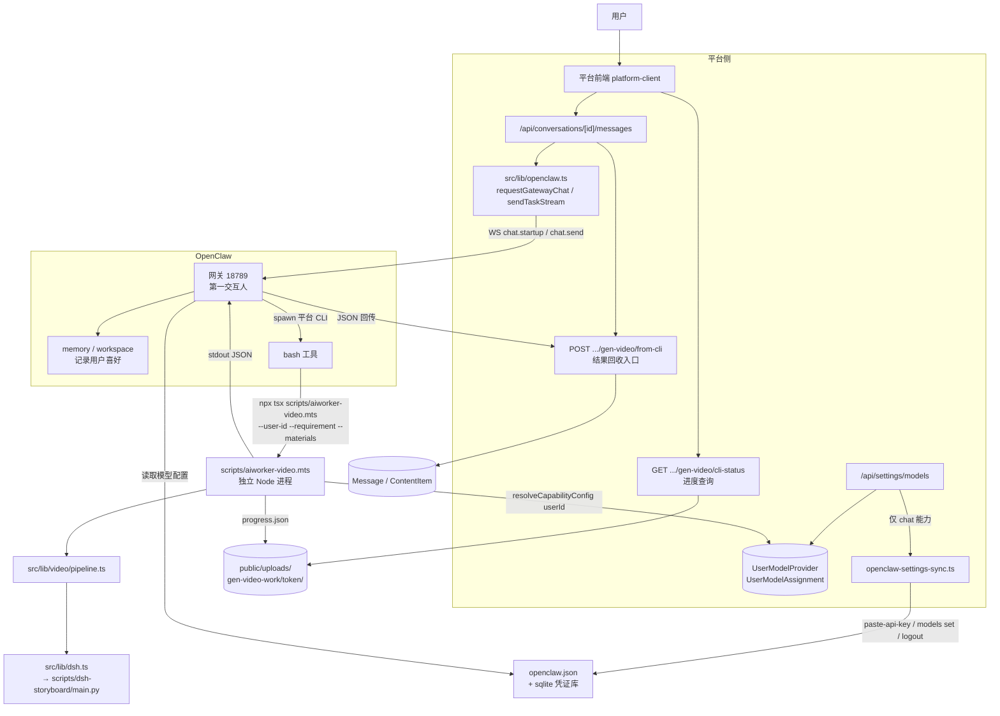

# OpenClaw 会话回归与视频链路重构方案

> 版本：v3.1（方案 C，已实施）
> 日期：2026-10-16（v3 更新于 2026-10-17，v3.1 实施完成于 2026-10-17）
> 分支：`Charles`（`0f03522` → 实施后未提交）
> 状态：**已实施，待端到端联调（需网关已启动）**

## 版本变更

| 版本 | 变更 |
| --- | --- |
| v1 | 初版，视频走方案 B（OpenClaw 路由决策、平台 HTTP 路由执行 DSH） |
| v2 | 视频改**方案 C**（OpenClaw 直接 spawn 平台 CLI，绕开 Next.js 进程）；补安全隔离设计 |
| v3 | 配置归属改为「只主对话模型归 OpenClaw，其余能力仍平台直连」。同步范围收窄到 chat 一项 |
| **v3.1** | **实施完成**。7 项任务全部落地，端到端跑通「方案 → 确认 → 出片」 |

---

## 实施记录（2026-10-17）

### 已完成的文件改动

| 文件 | 改动 |
| --- | --- |
| `src/lib/openclaw.ts` | 从 git 历史恢复 `requestGatewayChat` / `gatewayRequestWithRetry` / `deriveUserSessionKey` / `ChatContentItem`，并给 `openClawClient` 加回 `sendTask` / `sendTaskStream`。现存的 `connectGateway`、`requestGateway`、整套诊断层与微信绑定能力**原样保留未动** |
| `src/app/api/conversations/[id]/messages/route.ts` | 主链路由 `chatCompleteStream` 改为 `openClawClient.sendTaskStream`；**删除该路由的 chat 凭据解析**（改由 OpenClaw 自管）；新增 `buildVideoCapabilityBlock`（视频 CLI 协议注入，仅视频诉求时注入）与 `collectUserMaterialPaths`（注入该用户自己的素材路径）；错误消息统一走 `friendlyGatewayError` |
| `scripts/aiworker-video.mts` | **新增**。平台视频生成 CLI，OpenClaw 直接 spawn |
| `scripts/tsconfig.cli.json` | **新增**。CLI 专用类型配置（项目根 tsconfig 的 `include` 不含 `*.mts`，历史遗留旧脚本也有类型问题，故不直接改根配置） |
| `src/lib/video/plan-params.ts` | 新增 `parseLookFromFlags`（CLI 与面板共用同一份 look 校验规则） |
| `src/lib/video/storyboard.ts` | **修复既有 bug**：`toPlanSummary` 里 `(o.text ?? o.value ?? ...).trim()` 在 DSH 把 `value` 填成数字时抛 `…is not a function`，导致整条规划崩溃。改 `String(...)` 兜底 |
| `src/app/api/conversations/[id]/gen-video/from-cli/route.ts` | **新增**。产物回收入口（路径穿越校验 + Message/ContentItem/VideoPlan 落库） |
| `src/app/api/conversations/[id]/gen-video/cli-status/route.ts` | **新增**。进度查询（读 progress.json） |
| `src/lib/openclaw-settings-sync.ts` | **新增**。封装 `paste-api-key` / `models set` / `logout` 三个 CLI 调用 |
| `src/app/api/settings/models/route.ts` | 保存时，若该服务正被分配为 chat 且填了新 key，同步到 OpenClaw |
| `src/app/api/settings/assignments/route.ts` | 改 chat 分配时同步 key + 默认模型 |
| `src/app/api/settings/models/[providerId]/route.ts` | 删除 chat 服务时反向清理 OpenClaw auth profile |
| `src/app/settings-panel.tsx` | chat 行新增 OpenClaw 同步说明；新增同步失败提示（`syncError`） |
| `src/app/platform-client.tsx` | 新增视频任务进度卡片（3 秒轮询）+ `extractVideoToken` 检测助手回复里的视频 token |
| `src/renderer/styles.css` | 进度卡片与同步提示样式 |

### 关键实测结论

| 项 | 结论 |
| --- | --- |
| **CLI 端到端** | 阶段 1（方案）66.6s → 8 镜头 / 21.28s / DSH 非兜底；阶段 2（`--skip-plan` 渲染）164.9s → 成片 7.14 MB + 封面 115.9 KB，`progress.json` 终态正确 |
| **CLI 参数校验** | 无参 / 缺 `--user-id` / 素材不存在 / 未知参数 / 缺配置用户，5 个分支全部返回预期 JSON |
| **key 同步** | `paste-api-key` 走 stdin 管道**确认生效**（`models auth list --json` 可见 `deepseek:manual [deepseek/api_key]`） |
| **CLI 耗时** | `models auth list` 要 **38 秒**（OpenClaw CLI 启动慢，含 sqlite 打开与 provider 扫描）。最初设 20 秒超时导致全部误判超时，已放宽到 90 秒 |
| **Node 版本** | OpenClaw CLI 会校验 Node 运行时并自行 re-exec。用 `process.execPath` 若不匹配会导致父子进程关系断裂，故新增 `OPENCLAW_SYNC_NODE` 覆盖入口 |
| **`logout` 参数** | 真实签名是 `logout <profileId>`（**位置参数**，非 `--profile-id`），且必须带 `--yes` 跳过交互确认，否则无人值守调用会挂起 |

### 顺带修掉的既有 bug

`storyboard.ts` 的 `toPlanSummary`：DSH 偶而把 overlay 的 `value` 填成数字（如 `{"value":20}`），此时 `o.text` 为 `undefined`，`??` 链一路落到数字 `20`，再 `.trim()` 抛 `…is not a function`，**整条视频规划崩溃**。该 bug 在 `gen-video/plan` 面板路径同样会触发，非本次改动引入。

---

## 1. 背景与目标

### 1.1 起因

今天的 `873f44f`（模型 token 按用户隔离改造）把 `src/lib/openclaw.ts` **删除了 410 行**，其中包含 `requestGatewayChat` / `sendTask` / `sendTaskStream`。会话链路随之从 OpenClaw 网关改为 `chatCompleteStream` 直连用户配置的 OpenAI 兼容服务。

用户指出：**改造前会话本来就是走 OpenClaw 的**，由 OpenClaw 决定如何调用其他能力。经 git 历史核对，该记忆准确。

### 1.2 目标架构

OpenClaw（龙虾）成为与用户交互的**唯一第一人**：

- **向上**：理解用户意图、记录用户喜好、按用户隔离数据
- **向下**：调用工具；需要制作视频时，直接 spawn 平台提供的 DSH CLI 完成生成

系统配置中保存的主模型 API Key 需同步写入 OpenClaw 的模型配置，使会话实际读取的是 OpenClaw 里配置的模型信息。

---

## 2. 需求与决策记录

### 2.1 原始需求（用户原文）

> 我希望用户会话是和 openclaw 交互的。我记得模型配置按用户隔离前，用户会话就是和 openclaw 会话的，由 openclaw 决定如何调用其他能力，DSH 现阶段只用于视频。
>
> 另，我希望用户使用视频功能也是由 openclaw 做路由并发起，最终任务交给 DSH 执行。openclaw 是调用平台中 DSH 的接口生成视频。
>
> 用户主要与 openclaw 交互，openclaw 负责理解用户意图、记录用户喜好等，当用户需要制作视频时，由 openclaw 调用 DSH 生成视频。
>
> 总之，openclaw 就是与用户交互的第一人：向上负责理解用户，向下负责调用工具。
>
> 系统配置中，配置的主模型 api key 要设置到龙虾的模型配置中，会话中读取的是龙虾里配置的模型信息；会话中，龙虾来统一做用户数据隔离和理解用户意图，如果是视频任务，就走 dsh 来执行。

### 2.2 已确认决策

| # | 决策点 | 结论 |
| --- | --- | --- |
| D1 | 「龙虾」是什么 | OpenClaw 网关（`OPENCLAW_BASE_URL=http://localhost:18789`） |
| D2 | 网关由谁拉起 | **用户手动启动**，平台只当客户端连接，不做进程守护 |
| D3 | 两层模型配置关系 | **只主对话模型（chat）归 OpenClaw，其余能力仍平台直连** |
| D4 | 视频任务调用方式 | **方案 C：OpenClaw 直接 spawn 平台的 DSH 脚本/CLI，绕开平台进程** |

### D3 的方案演进（重要）

| 版本 | 方案 | 问题 |
| --- | --- | --- |
| v1 | Prisma 保留 + 同步一份给 OpenClaw | 两份配置需要一致性处理（以谁为准、冲突如何解决、删除如何联动），复杂度高 |
| **v3（现行）** | **能力归属划分，各消费方各取所需** | 无一致性问题 |

**v3 的归属划分**：

| 能力 | 权威来源 | 消费方 |
| --- | --- | --- |
| **chat（主对话模型）** | **OpenClaw**（`openclaw.json` + sqlite 凭证库） | 用户会话（唯一入口） |
| vision / ocr | Prisma（`UserModelProvider` + `UserModelAssignment`） | 平台识图、OCR |
| tts | Prisma | 平台配音（edge-tts 通道） |
| storyboard | Prisma | DSH 分镜 |
| embedding / search | Prisma | 知识库向量、联网检索 |
| video | Prisma | 视频生成路由 |

**为什么不需要"一致性处理"**：系统配置保存主模型 key 时，**同一次写入**分别落到 Prisma 和 OpenClaw 两个独立的消费方。不存在双向同步、不存在冲突解决、不存在"以谁为准"的判断 —— 因为：

- 会话只读 OpenClaw，永不回头读 Prisma 的 chat 分配
- 平台侧功能（今日热点、一键仿写、`prepare` 的 `chatComplete`、`narration` 的 `chatComplete`）只读 Prisma
- 两边是**平行的消费关系**，不是主从镜像关系

> **注意**：平台侧仍有若干功能需要 chat 能力（今日热点整理、一键仿写、`prepare` 创作要求、旁白生成）。这些**不是**"用户与 OpenClaw 对话"，属平台自有逻辑，继续读 Prisma 的 chat 分配。因此 chat 在 Prisma 中**仍然保留**，只是不再是会话的主链路来源。

### 2.3 D4 的方案演进（重要）

| 版本 | 方案 | 说明 |
| --- | --- | --- |
| B（初版） | OpenClaw 做路由决策，**平台 Next.js 路由**执行 DSH | OpenClaw 不直接碰 DSH，安全边界最清晰 |
| **C（现行）** | **OpenClaw 直接 spawn 平台 CLI**，绕开 Next.js 进程 | 用户明确改为 C，并指出「密钥与素材隔离要重新设计」 |

C 相对 B 的差异：

| 维度 | B | C |
| --- | --- | --- |
| 视频触发路径 | OpenClaw → 平台 HTTP 路由 → pipeline | OpenClaw → 平台 CLI → pipeline |
| 执行载体 | `/api/conversations/[id]/gen-video/*` | `scripts/aiworker-video.mts`（独立 Node 进程） |
| OpenClaw 触达深度 | 平台 HTTP 接口 | 平台 CLI（经其 bash 工具） |
| 落库方式 | 路由内直接写 | CLI 输出 JSON → OpenClaw 回传平台接口落库 |

---

## 3. 现状分析（技术事实，均经实测/读码核实）

### 3.1 改造前的会话链路（`873f44f~1`）

```
src/app/api/conversations/[id]/messages/route.ts
  └─ openClawClient.sendTask() / sendTaskStream()
       └─ requestGatewayChat(message, timeoutMs, onDelta, sessionKeyOverride)
            ├─ connectGateway()              # WS 连接，300s 连接预算
            ├─ chat.startup { sessionKey }
            ├─ chat.send { sessionKey, message, deliver:false, idempotencyKey } → runId
            └─ 事件流收最终回复，track 累计 delta
```

- 按登录用户派生 session key：`process.env.OPENCLAW_SESSION_KEY || "agent:main:main"`
- prompt 注入平台上下文：该用户的定时任务平台接口、微信通知投递目标、禁用 `openclaw cron`

### 3.2 OpenClaw CLI 能力（版本 2026.10.1 / e178c39）

CLI 位置：`C:\Users\Charles\AppData\Roaming\npm\openclaw.ps1`

| 命令 | 用途 |
| --- | --- |
| `openclaw agent -m <text> --session-key <key> --json` | 跑一轮 agent；`--session-key` 支持按用户隔离，`--json` 结构化输出 |
| `openclaw agent --message-file <path>` | 从 UTF-8 文件读消息（上限 4 MiB），绕开命令行长度限制 |
| `openclaw agent --model <id>` | 单次模型覆盖 |
| `echo "<key>" \| openclaw models auth paste-api-key --provider <name>` | **保存 API key 到 auth profile 并更新 config** |
| `openclaw models set <model>` | 设默认模型 |
| `openclaw models status --json` | 查已配置模型状态 |
| `openclaw models auth list` / `logout` | 列 / 删 auth profile |

**关键实测结论**：

- `paste-api-key` 的 key 读取实现为 `process.stdin.isTTY ? password(prompt) : readPipedStdin()` —— **非 TTY（管道）时读 stdin，可无人值守调用**
  （实现位于 `~/AppData/Roaming/npm/node_modules/openclaw/dist/auth-DFfKdikU.mjs`）
- `paste-api-key` 会调用 `refreshRunningGatewayAuthState(agentId, "login")` 刷新运行中网关的凭据

### 3.3 OpenClaw 的配置与凭据存储

`~/.openclaw/openclaw.json` 结构：

```json
{
  "auth": { "profiles": { "deepseek:manual": { "provider": "deepseek", "mode": "api_key" } } },
  "models": {
    "providers": {
      "deepseek": {
        "api": "openai-completions",
        "baseUrl": "https://api.deepseek.com",
        "models": [{ "id": "deepseek-flash", "name": "DeepSeek Flash" }]
      }
    }
  },
  "agents": { "defaults": { "model": { "primary": "deepseek/deepseek-flash" } } },
  "gateway": { "auth": { "mode": "token" } }
}
```

**关键约束**：API key **不在** `openclaw.json` 中，只存 `auth.profiles` 的引用；真实 key 位于 OpenClaw 私有的 sqlite 凭证库（格式未公开）。因此同步 key **必须**走 `paste-api-key` CLI，不能直接写 JSON。

### 3.4 DSH 现状

- `scripts/dsh-storyboard/main.py`：职责极窄——「只把一段 prompt 交给 DeepSeek Harness，取回一段纯文本」
  - 协议：stdin `{prompt, session_id, cwd, dsh_home, patch, model, timeout_ms}` → stdout `{ok, final_response?, elapsed_ms?, error?}`，exit 永远 0
  - 底层 `deepseek-harness-sdk`，profile 默认 `sdk`（自带 tool-bash / tool-fs / tool-web / subagent），当前靠 patches 覆盖层逐个 disabled
- Node 侧 `src/lib/dsh.ts`：`spawn(python, [bridgeDir()/main.py])`，`DSH_CAPABILITY = "storyboard"`，凭据走 `resolveCapabilityConfig(userId, "storyboard")`
- 调用点仅两处：`src/lib/video/pipeline.ts:971`（分镜规划）、`gen-video/prepare/route.ts:318`（创作要求降级）

### 3.5 视频全链路构成（CLI 必须编排的全部环节）

`src/lib/video/pipeline.ts` 的 `runVideoPlanStage` / `runVideoRenderStage`：

| 阶段 | 函数 | 能力 |
| --- | --- | --- |
| 素材归一化 | `normalizeMaterials` | — |
| 识图 | `insightImages` | vision |
| 风格推断 | `inferStyle` | — |
| 旁白 | `generateNarrationScript` | chat |
| 配音 | `synthesizeNarration` | tts（edge-tts Python 子进程） |
| 分镜 | `runDshText` | storyboard（DSH Python 子进程） |
| 渲染 | Remotion（Node） | — |
| 字幕 | ffmpeg 烧录 | — |

**可行性关键**：`pipeline.ts` 只 import node 内置模块 + 项目内 lib，**无 Next.js 运行时依赖**。今天已用 `scripts/probe-plan-stage.mts` 实测：`npx tsx` 直接 import `runVideoPlanStage` 并跑通（DSH 分镜 7 段非兜底、95 字旁白、19.36 秒配音、look 覆盖与特效并集生效、JSON 往返一致）。

### 3.6 平台侧现有体系（保留，但 chat 的角色变化）

- `src/lib/model-credentials.ts`：`resolveCapabilityConfig(userId, capability)` / `snapshotUserConfig` / `ModelConfigError`（kind: `no_provider` / `no_assignment` / `invalid_key`）；只读 Prisma，无 env 兜底
- Prisma 表：`UserModelProvider`（AES-256-GCM 加密密钥）、`UserModelAssignment`（8 项能力）、`VideoPlan`、`OpenClawTask`、`Message`、`ContentItem`
- `/api/settings/*` + `src/app/settings-panel.tsx`
- 视频 HTTP 路由：`gen-video/plan`（规划）、`gen-video`（渲染，支持 `planToken`）
- 素材落盘目录：`public/uploads/gen-video-refs/<token>/`

**改造后 chat 的双轨角色**：

| 场景 | 读哪里的 chat 配置 |
| --- | --- |
| 用户在对话框发消息（会话） | **OpenClaw**（`openclaw.json` + sqlite） |
| 今日热点整理（`prepare`） | Prisma |
| 一键仿写·拆解 / 成稿 | Prisma |
| 旁白文案生成（`narration.ts`） | Prisma |
| 视频 CLI 内的旁白生成 | Prisma（CLI 按 `--user-id` 自取） |

> 换言之：**"和用户对话"归 OpenClaw，"平台自己干活"归 Prisma**。这个划分是 v3 的核心。

### 3.7 网关当前状态

**未运行**：18789 端口不通、无进程、无监听。按 D2 由用户手动启动。

---

## 4. 目标架构



### 4.1 数据流说明

1. **会话**：用户消息 → `messages` 路由 → `requestGatewayChat`（WS）→ OpenClaw 网关。OpenClaw 按 `session-key`（每用户独立）隔离会话，读取自己的模型配置（`openclaw.json` + sqlite 凭证库）。
2. **视频发起**：OpenClaw 识别视频意图后，用 bash 工具 spawn 平台 CLI：
   ```
   npx tsx scripts/aiworker-video.mts \
     --user-id <userId> --requirement "..." --materials <p1> <p2> \
     [--theme X] [--target-seconds N] [--look-effects glitch] [--look-motion ken-burns] [--caption-style bold-yellow]
   ```
3. **CLI 执行**：凭 `--user-id` 自行从平台库取该用户密钥，编排识图 → 风格 → 旁白 → 配音 → DSH 分镜 → Remotion 渲染 → ffmpeg 字幕；进度写 `<workDir>/progress.json`，终态 JSON 写 stdout。
4. **结果回流**：OpenClaw 捕获 stdout JSON，回传 `POST .../gen-video/from-cli`，平台创建 `Message` + `ContentItem`。
5. **进度展示**：前端轮询 `GET .../gen-video/cli-status?token=<token>`。

---

## 5. 详细设计

### 5.1 恢复 OpenClaw 会话通道

**文件**：`src/lib/openclaw.ts`（MODIFY）

从 `git show 873f44f~1:src/lib/openclaw.ts` 取回被删的 410 行，包含：

- `connectGateway()`：WS 连接，带 `isGatewayTransientError` 判断与 300 秒连接预算（覆盖网关 4-5 分钟的重启窗口）
- `gatewayRequestWithRetry()`：单次请求的重试
- `requestGatewayChat(message, timeoutMs, onDelta, sessionKeyOverride)`：`chat.startup` → `chat.send` → 事件流收最终回复并 track 累计 delta
- `friendlyGatewayError()`：把连接错误翻译成可操作提示
- `sendTask()` / `sendTaskStream()`：对外入口

**合并要求**：不得覆盖现存的 `warmupWeixinLoginModule`、`openClawClient`（微信绑定 5 方法）、`probeGatewayHandshake`。

**兜底通道**：`openclaw agent -m <text> --session-key <key> --json` CLI 子进程作为 WS 不可用时的备选（无增量 delta，只有最终结果）。

### 5.2 messages 路由改造

**文件**：`src/app/api/conversations/[id]/messages/route.ts`（MODIFY）

| 项 | 改造前（当前） | 改造后 |
| --- | --- | --- |
| 主链路 | `chatCompleteStream`（`llm-client.ts:272`） | `openClawClient.sendTaskStream` |
| 凭据解析 | `resolveCapabilityConfig(user.id, "chat")` | **不再需要**——OpenClaw 读自己的模型配置 |
| session | 无 | 按用户派生 session key |

> **凭据含义的变化**：改造前平台要先解析该用户的 chat 分配才能调模型；改造后这一步删除，OpenClaw 自行决定用哪个模型（用户可在 OpenClaw 侧切换）。这是"OpenClaw 是第一交互人"的直接体现 —— 模型选择权也归它。

**错误分类**（`src/lib/model-credentials.ts` MODIFY）：

新增 `GatewayUnavailableError`，与 `ModelConfigError` 并列，kind 建议取 `gateway_unavailable`。触发条件：WS 连接失败 / 连接预算耗尽。文案必须可操作，例如：

> 无法连接 OpenClaw 网关（http://localhost:18789）。请先启动 OpenClaw 网关后重试。

**清理遗留文案**：`route.ts:1259` / `:1266` 的「OpenClaw 调用失败」在本次改造后语义已变化，需一并校正。

**保留的特殊指令分支**：今日热点（`:742` `chatComplete`）、一键仿写·拆解（`:872`）、仿写·成稿（`:896`）暂时仍走 `chatCompleteStream`（它们不是"用户与 OpenClaw 对话"，是平台侧的辅助功能）。**待确认**：是否也要改走 OpenClaw。

### 5.3 平台上下文注入

**位置**：`messages` 路由组装 prompt 处（复用改造前的注入机制）

需注入的内容：

| 类别 | 内容 |
| --- | --- |
| **视频 CLI 协议** | 命令行签名、每个参数含义、输出 JSON 格式、调用示例 |
| 该用户的定时任务平台接口 | 与改造前一致 |
| 微信通知投递目标 | 与改造前一致 |
| 禁用 `openclaw cron` | 与改造前一致 |
| 该用户的素材路径清单 | 用户上传后由平台注入（见 5.4） |

**视频 CLI 协议注入示例**（要点，非最终文案）：

```
你可以通过执行下面的命令让平台生成视频（命令需原样执行，不要改写参数名）：

  npx tsx scripts/aiworker-video.mts \
    --user-id <当前用户ID> \
    --requirement "<创作要求>" \
    --materials <图片路径1> <图片路径2> ... \
    [--theme <主题key>] [--target-seconds <秒数>] \
    [--look-effects <特效,特效>] [--look-motion <运镜>] [--caption-style <字幕样式>]

输出：stdout 最后一行是 JSON：
  {"ok":true,"token":"...","title":"...","videoPath":"...","coverPath":"...",
   "durationSeconds":19.4,"narration":"...","sceneCount":7}
失败时：{"ok":false,"error":"..."}

拿到 JSON 后，把 videoPath / title / narration 等信息自然地转述给用户。
```

### 5.4 平台视频 CLI

**文件**：`scripts/aiworker-video.mts`（NEW）

```
用法：
  npx tsx scripts/aiworker-video.mts \
    --user-id <id> --requirement <文本> --materials <路径...> \
    [--theme <key>] [--target-seconds <n>] \
    [--look-effects <a,b>] [--look-motion <m>] [--caption-style <s>] \
    [--token <token>] [--skip-plan] [--tts-provider <p>]
```

**职责**：

1. 解析参数（严格校验：`--user-id` 与 `--materials` 必填）
2. 调 `runVideoPlanStage`（识图 → 风格 → 旁白 → 配音 → DSH 分镜）
3. 进度写入 `<workDir>/progress.json`
4. 调 `runVideoRenderStage`（Remotion 渲染 + ffmpeg 字幕）
5. stdout 输出最终 JSON，exit 0 / 1

**进度文件格式**（`<workDir>/progress.json`）：

```json
{
  "token": "1731686400000-ab12cd",
  "stage": "rendering",
  "percent": 62,
  "message": "正在渲染第 5/7 个镜头…",
  "updatedAt": "2026-10-16T20:30:00.000Z",
  "terminal": false
}
```

阶段取值：`normalizing` → `vision` → `narration` → `tts` → `storyboard` → `rendering` → `done` / `failed`。
写盘节流：同一阶段内最多每 500ms 写一次，避免高频 IO。

**密钥获取**（安全核心）：CLI 内部 import `resolveCapabilityConfig(userId, capability)`，按 userId 从平台 SQLite 取该用户加密密钥。**OpenClaw 不接触任何密钥。**

**`--skip-plan` 语义**：默认走完整 plan + render（保留方案确认能力）；`--skip-plan` 则规划后直接渲染，用于 OpenClaw 已与用户确认过的场景。

**复用现有逻辑**：`--theme` / `--target-seconds` / `--look-*` / `--tts-provider` 全部透传给既有 pipeline 入参，缺省值与 HTTP 路由一致（`parseTargetSeconds` 等）。

### 5.5 结果回收入口

**文件**：`src/app/api/conversations/[id]/gen-video/from-cli/route.ts`（NEW）

```
POST /api/conversations/[id]/gen-video/from-cli
Body: { token, title, narration, videoPath, coverPath, durationSeconds, sceneCount, theme, diagnostics? }
```

职责：

1. 校验 `videoPath` 位于该用户工作目录内（防路径穿越）
2. 把产物复制/移动到 `public/uploads/gen-video-out/<token>/`
3. 创建 `Message`（assistant，content 含标题与旁白）+ `ContentItem`（内容库）
4. 返回 `{ ok: true, videoUrl, coverUrl, messageId }`

**安全约束**：CLI 无数据库写权限，所有写入经此接口完成；接口校验 token 归属（`workDir` 路径含 token，需与 `VideoPlan`/工作目录记录比对）。

### 5.6 进度查询接口

**文件**：`src/app/api/conversations/[id]/gen-video/cli-status/route.ts`（NEW）

```
GET /api/conversations/[id]/gen-video/cli-status?token=<token>
→ { ok, stage, percent, message, terminal, videoUrl? }
```

读取 `<workDir>/progress.json`；`terminal=true` 时附上最终产物 URL。token 不存在返回 404（任务可能尚未开始写盘）。

### 5.7 前端进度卡片与网关提示

**文件**：`src/app/platform-client.tsx`、`src/renderer/styles.css`（MODIFY）

- **视频进度卡片**：会话中检测到视频任务（`cli-status` 返回进行中）时展示，含阶段文案、百分比、完成/失败态。轮询间隔 3 秒，终态停止。
- **网关不可用提示**：输入框上方展示可操作提示条（「无法连接 OpenClaw 网关，请先启动后重试」），复用现有 `CAPABILITY_FALLBACK_NOTE` 的呈现模式。
- 样式沿用现有设计系统（主色 `#2B7CFF`，PingFang SC），不改变既有导航与布局。

#### 5.7.1 系统配置页的同步说明（决策 4：需加）

**文件**：`src/app/settings-panel.tsx`（MODIFY）

在「默认模型分配」的 **chat（对话创作）** 一行下方新增说明：

> 主对话模型的 API Key 保存后会同步到 OpenClaw，会话实际使用 OpenClaw 里的模型配置。修改后需重启 OpenClaw 网关方可生效。

**为什么必须加**：改造后会话的模型选择权在 OpenClaw 侧。用户在系统配置改 chat 模型时，如果没有任何说明，会预期"立刻生效"，实际却可能因为网关缓存旧配置而无变化 —— 这会变成一个极难自查的问题（用户以为平台坏了）。

**实现要点**：
- 说明仅在 chat 行展示，其它 6 项能力行不展示（它们不涉及 OpenClaw）
- 复用现有 `CAPABILITY_FALLBACK_NOTE` 的呈现模式（`settings-panel.tsx` 中已有的提示条样式）
- 保存接口返回 `openclawSync: { ok: false, reason }` 时，在该行下方追加红色错误提示（如「同步到 OpenClaw 失败：未找到 openclaw 命令」），但不阻断保存

### 5.8 OpenClaw 配置同步（仅 chat 能力）

**文件**：`src/lib/openclaw-settings-sync.ts`（NEW）

```ts
export type SyncResult = { ok: true } | { ok: false; reason: string };

/** 把平台侧主对话模型 key 同步进 OpenClaw（stdin 管道，非 TTY）。 */
export async function syncModelKeyToOpenClaw(input: {
  provider: string;
  apiKey: string;
  profileId?: string;
}): Promise<SyncResult>;

/** 设置 OpenClaw 默认模型。 */
export async function setOpenClawDefaultModel(model: string): Promise<SyncResult>;

/** 删除主对话模型服务时清理 OpenClaw 侧 auth profile。 */
export async function removeOpenClawAuthProfile(profileId: string): Promise<SyncResult>;
```

实现要点：

- 统一用 `spawn` + `windowsHide: true` + 超时（建议 20s）
- key 经 **stdin 管道**传入，**绝不出现在命令行参数里**（会进进程列表/日志）
- CLI 不存在（`ENOENT`）→ 返回 `{ ok: false, reason: "未找到 openclaw 命令" }`
- provider 名映射：平台 provider id → OpenClaw provider id（`deepseek` / `openai` / `zhipu` 等；未知 provider 跳过同步并记录）
- 所有失败只 `console.error` + 返回 reason，**不阻断 Prisma 主流程**

**同步范围（v3 收窄）**：**只同步 chat 能力**。识图、OCR、TTS、分镜、向量、搜索这 6 项不同步 —— 它们由平台直连消费，OpenClaw 用不到，写过去只会造成两份无用配置。

**挂载点**：`src/app/api/settings/models/route.ts`（MODIFY）

| 时机 | 动作 |
| --- | --- |
| 新增/更新模型服务 | 写 Prisma；**若该服务被分配为 chat 能力**，额外 `syncModelKeyToOpenClaw` |
| 删除模型服务 | 写 Prisma；**若删除的是 chat 服务**，额外 `removeOpenClawAuthProfile(profileId)` |
| 在「默认模型分配」里把某项设为 chat | `syncModelKeyToOpenClaw` + `setOpenClawDefaultModel(model)` |
| 其它能力（vision/ocr/tts/…）的分配变更 | **不触发 OpenClaw 同步** |

失败时在接口响应中带 `openclawSync: { ok: false, reason }`，前端在系统配置页提示（不阻断保存）。

---

## 6. 安全与隔离设计

用户在原需求中特别指出「密钥与素材隔离要重新设计」。实际结论是：**不需要引入第二套隔离机制，且方案 C 的隔离边界比 B 更严**。

### 6.1 密钥隔离

| 凭据 | 存放处 | 谁能拿到 |
| --- | --- | --- |
| **主对话模型 key（chat）** | OpenClaw 私有 sqlite（`paste-api-key` 写入） | OpenClaw 网关（会话要用） |
| 其余 6 项能力 key | 平台 SQLite（`UserModelProvider.credentialEnc`，AES-256-GCM） | 平台 CLI（按 `--user-id` 自取） |

**两条互不流通的凭据链**：

- **chat key**：用户在系统配置填写 → 同一次保存分别写 Prisma（供平台辅助功能）+ OpenClaw sqlite（供会话）。OpenClaw 能读自己的 chat key，但**读不到平台库里其它 6 项能力的 key**
- **能力 key**：CLI 内部 `resolveCapabilityConfig(userId, capability)` 从平台 SQLite 取。**OpenClaw 完全不接触**，它只传 `--user-id` 字符串

设计原则：**OpenClaw 不需要知道平台用哪个 key 才能让平台干活** —— 它只需要知道"这是哪个用户"。

> v3 相对 v2 的变化：v2 中 OpenClaw 完全摸不到任何 key；v3 中 chat key 明确交给 OpenClaw（因为会话要由它发起，它必须有自己的模型凭据）。但**其余 6 项能力的 key 仍然对 OpenClaw 完全屏蔽**。

### 6.2 素材隔离

- 用户上传的素材由平台落盘到 `public/uploads/gen-video-refs/<token>/`
- 上传时把**该用户自己的**素材路径清单注入 OpenClaw 上下文（复用改造前的上下文注入机制）
- OpenClaw 只传路径字符串，不接触文件内容，也无法构造他人路径（路径由平台给定）

### 6.3 产物归属

- CLI **无状态**：只产文件 + 向 stdout 输出 JSON，**不写数据库**
- 落库由 `from-cli` 接口完成，OpenClaw 持 JSON 回传
- **数据写入权始终在平台**：即使 CLI 被滥用也碰不到 `Message` / `ContentItem` / `VideoPlan`

### 6.4 路径安全

`from-cli` 接口必须校验 `videoPath` / `coverPath` 位于该 token 对应的工作目录内，拒绝 `..` 穿越与绝对路径逃逸。

---

## 7. 错误处理与降级

| 场景 | 行为 |
| --- | --- |
| 网关未启动 / 连不上 | `GatewayUnavailableError` → 会话返回可操作提示（"请启动 OpenClaw 网关"），不暴露堆栈 |
| WS 不可用但 CLI 可用 | 降级到 `openclaw agent --json` 子进程（无增量 delta） |
| **用户在 OpenClaw 侧未配模型** | 会话报错由 **OpenClaw 自己产生**（它读自己的配置），平台只透传。需在系统配置页提示"主对话模型需在系统配置填写，保存后会同步到 OpenClaw" |
| 平台侧功能未配 chat（今日热点/仿写/旁白） | `ModelConfigError`（Prisma 分配缺失），与现状一致 |
| CLI 缺参数 | exit 1 + `{"ok":false,"error":"缺少必填参数 --user-id"}` |
| CLI 中途失败（如 TTS 403） | progress.json 写 `failed` + error；stdout 输出 `{"ok":false,...}`；OpenClaw 转述给用户 |
| `openclaw` CLI 不存在 | `syncModelKeyToOpenClaw` 返回 reason，系统配置页提示，Prisma 保存不受影响 |
| provider 无法映射到 OpenClaw | 跳过同步并记录日志 |

---

## 8. 任务分解与依赖

| # | ID | 任务 | 依赖 | 产出 |
| --- | --- | --- | --- | --- |
| 1 | `recover-openclaw-gateway` | 从 git 历史恢复 `requestGatewayChat`/`sendTask`/`sendTaskStream`，与现存微信绑定能力合并 | — | `src/lib/openclaw.ts` |
| 2 | `rewire-messages-route` | messages 路由改走 OpenClaw；按用户派生 session key；注入平台上下文（含视频 CLI 协议）；新增 `GatewayUnavailableError`；**删除该路由的 chat 凭据解析** | 1 | `messages/route.ts`、`model-credentials.ts` |
| 3 | `video-intent-module` | 新增 `src/lib/video-intent.ts`（`VideoIntent` 类型 + `parseVideoIntent`）+ 平台视频 CLI `scripts/aiworker-video.mts` | 2 | `video-intent.ts`、`aiworker-video.mts` |
| 4 | `video-progress-feedback` | `from-cli` 回收入口 + `cli-status` 进度查询 + 前端进度卡片与网关提示 | 3 | 两个路由、`platform-client.tsx`、`styles.css` |
| 5 | `openclaw-settings-sync` | 封装 `paste-api-key` / `models set` / `models auth logout` 三个 CLI 调用 | — | `openclaw-settings-sync.ts` |
| 6 | `wire-settings-sync` | `/api/settings/models` 与能力分配中，**仅 chat 相关的保存/删除**触发 OpenClaw 同步；其余能力不触发 | 5 | `settings/models/route.ts`、`settings-panel.tsx` |
| 7 | `verify-and-doc` | tsc 校验 + 端到端验证 + 补架构文档 | 4、6 | 本文档更新 |

> 任务 5、6 与 1-4 无依赖，可并行推进。
> **v3 简化点**：任务 6 不再需要处理"两份配置一致性"，只需判断「这次保存是否涉及 chat 能力」。

---

## 9. 风险与缓解

| # | 风险 | 影响 | 缓解 |
| --- | --- | --- | --- |
| R1 | **网关未运行**，端到端验证受阻 | 高 | 实现期间由用户手动启动网关；CLI 层可先用 mock 验证 |
| R2 | `npx tsx` 每次启动开销 1-2s | 中 | 可接受；若 OpenClaw 高频 spawn 再考虑 build 成 JS |
| R3 | 恢复的 410 行与现存微信绑定代码合并冲突 | 中 | 逐函数核对，合并后立即 `tsc --noEmit` |
| R4 | session key 派生算法变更导致历史会话丢失 | 中 | 与改造前保持一致；如需变更需明确迁移规则 |
| R5 | OpenClaw 输出不稳定，CLI 参数拼错 | 中 | prompt 给明确示例；CLI 对参数做严格校验并返回可读错误 |
| R6 | `paste-api-key` 在 OpenClaw 升级后行为变化 | 中 | 已锁定实测版本 2026.10.1；同步失败不阻断主流程 |
| R7 | 视频产物路径被 OpenClaw 读取 | 低 | 可让 CLI 只输出 `{token, title, durationSeconds}`，由 `from-cli` 凭 token 查详情（按需启用） |
| R8 | 前端轮询造成请求压力 | 低 | 3 秒间隔 + 终态停止；progress.json 写盘节流 500ms |

---

## 10. 验证计划

| 阶段 | 验证项 | 方法 |
| --- | --- | --- |
| 单元 | `parseVideoIntent` 对各种 OpenClaw 输出的容错 | 脚本喂样本（JSON 代码块 / 裸 JSON / 缺字段 / 无指令） |
| 单元 | `syncModelKeyToOpenClaw` 管道传 key | `echo "sk-test" \| openclaw models auth paste-api-key --provider deepseek` 实测 |
| 集成 | CLI 独立跑通全链路 | `npx tsx scripts/aiworker-video.mts --user-id <测试用户> --requirement "..." --materials <图>` |
| 集成 | `from-cli` 落库 + 路径校验 | 正常 JSON + 恶意 `..` 路径各跑一次 |
| 集成 | `cli-status` 进度读取 | CLI 运行中轮询 |
| 端到端 | 用户会话 → OpenClaw → CLI → 回流 | **需网关已启动**，由用户手动拉起后验证 |
| 回归 | 面板手动出片仍正常 | `gen-video/plan` + `gen-video` HTTP 路径不变 |
| 静态 | `npx tsc --noEmit` 通过 | CI |

---

## 11. 附录

### 11.1 关键代码位置

| 路径 | 说明 |
| --- | --- |
| `git show 873f44f~1:src/lib/openclaw.ts` | 被删的 410 行（恢复来源） |
| `git show 873f44f~1:src/app/api/conversations/[id]/messages/route.ts` | 改造前会话路由（注入模板来源） |
| `src/lib/openclaw.ts` | 现存：微信绑定 + 健康检查 |
| `src/app/api/conversations/[id]/messages/route.ts` | 当前会话路由（`:1085` 凭据、`:1135` 主链路、`:1259/:1266` 遗留文案） |
| `src/lib/video/pipeline.ts` | `runVideoPlanStage` / `runVideoRenderStage` |
| `src/lib/model-credentials.ts` | `resolveCapabilityConfig` / `ModelConfigError` |
| `src/lib/dsh.ts` | DSH 子进程封装 |
| `src/app/api/conversations/[id]/gen-video/plan/route.ts` | 规划 HTTP 接口（保留） |
| `src/app/api/conversations/[id]/gen-video/route.ts` | 渲染 HTTP 接口（保留） |
| `src/app/api/settings/models/route.ts` | 系统配置保存/删除 |
| `scripts/dsh-storyboard/main.py` | DSH bridge（不改职责） |
| `~/AppData/Roaming/npm/node_modules/openclaw/dist/auth-DFfKdikU.mjs` | `paste-api-key` / `readPastedSecret` 实现 |

### 11.2 OpenClaw CLI 速查

```bash
# 会话
openclaw agent -m "消息" --session-key agent:main:user-<id> --json
openclaw agent --message-file ./msg.txt --session-key <key> --json

# 模型配置同步
echo "sk-xxx" | openclaw models auth paste-api-key --provider deepseek
openclaw models set deepseek/deepseek-flash
openclaw models status --json
openclaw models auth list
openclaw models auth logout --profile-id deepseek:manual
```

### 11.3 约束

- tsconfig target 低于 ES2018：正则不能用 `/s` 与 `\p{P}`
- 不改动 `.env.local` 中的平台级凭据（`SCHEDULE_API_TOKEN` / `CONTENT_INGEST_TOKEN` / `AUTH_SESSION_SECRET` 等）
- Windows：`spawn` 需 `windowsHide: true`；给用户执行的 `.cmd/.bat` 必须纯 ASCII
- 所有 Prisma 查询继续强制带 `userId`
- DSH 职责边界保持「仅视频」，不改造为通用 agent

### 11.4 已确认决策（2026-10-17）

| # | 问题 | 结论 |
| --- | --- | --- |
| 1 | 今日热点 / 一键仿写是否改走 OpenClaw | **不改造**，继续走 `chatCompleteStream`（读 Prisma）。它们是平台自有逻辑，不是"用户与 OpenClaw 对话" |
| 2 | CLI 输出是否最小化（不暴露视频绝对路径） | **不改造**，保持输出完整 JSON（`videoPath` / `coverPath` / `title` / `narration` 等）。OpenClaw 只回传该用户自己的产物路径，不构成越权 |
| 3 | 前端进度轮询间隔 | **不改造**，保持 3 秒 |
| 4 | 系统配置页是否加「主对话模型保存后同步到 OpenClaw」说明 | **是**，需加（见 5.7.1） |

---

## 附录 A：任务清单（实施用）

| # | ID | 任务 | 依赖 | 主要文件 |
| --- | --- | --- | --- | --- |
| 1 | `recover-openclaw-gateway` | 从 git 历史恢复 `requestGatewayChat`/`sendTask`/`sendTaskStream`，与现存微信绑定能力合并 | — | `src/lib/openclaw.ts` |
| 2 | `rewire-messages-route` | messages 路由改走 OpenClaw；按用户派生 session key；注入平台上下文（含视频 CLI 协议）；新增 `GatewayUnavailableError`；删除该路由的 chat 凭据解析 | 1 | `messages/route.ts`、`model-credentials.ts` |
| 3 | `video-intent-module` | `src/lib/video-intent.ts`（`VideoIntent` + `parseVideoIntent`）+ 平台视频 CLI `scripts/aiworker-video.mts` | 2 | 两个新文件 |
| 4 | `video-progress-feedback` | `from-cli` 回收入口 + `cli-status` 进度查询 + 前端进度卡片与网关提示 + **系统配置页同步说明** | 3 | 两个新路由、`platform-client.tsx`、`settings-panel.tsx`、`styles.css` |
| 5 | `openclaw-settings-sync` | 封装 `paste-api-key` / `models set` / `models auth logout` | — | `src/lib/openclaw-settings-sync.ts` |
| 6 | `wire-settings-sync` | `/api/settings/models` 与能力分配中，**仅 chat 相关**的保存/删除触发同步 | 5 | `settings/models/route.ts` |
| 7 | `verify-and-doc` | tsc 校验 + 端到端验证 + 文档更新 | 4、6 | 本文档 |

> 任务 5、6 与 1-4 无依赖，可并行。
> **前置条件**：端到端验证需 OpenClaw 网关已启动（18789 端口），由用户手动拉起。
